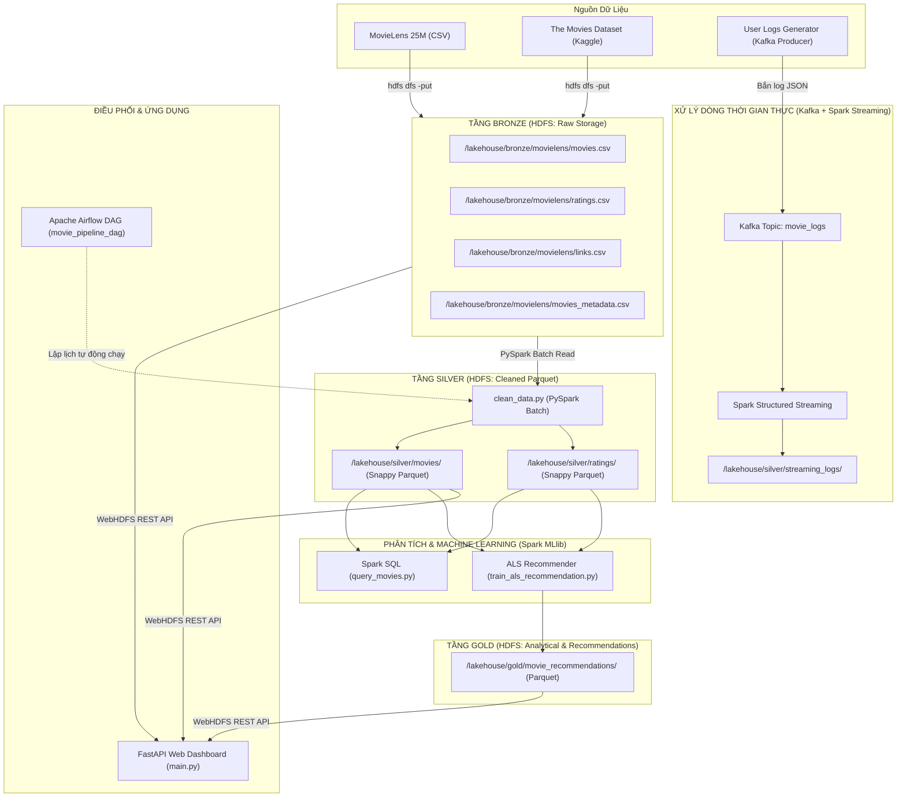

# BÁO CÁO CHI TIẾT ĐỒ ÁN MÔN HỌC DỮ LIỆU LỚN (BIG DATA)

**ĐỀ TÀI:** XÂY DỰNG HỆ THỐNG GỢI Ý PHIM TRỰC TUYẾN DỰA TRÊN KIẾN TRÚC LAKEHOUSE VÀ ĐIỆN TOÁN PHÂN TÁN  
**MÔI TRƯỜNG THỰC NGHIỆM:** Ubuntu 26.04 (WSL2), Python 3.14, OpenJDK 8, Hadoop 3.3.6, PySpark 3.5.1, Kafka 3.6.2 (KRaft), Airflow 3.3.2.

---

## I. TỔNG QUAN ĐỀ TÀI & BỘ DỮ LIỆU

### 1. Mục tiêu đề tài
Xây dựng một hệ thống xử lý dữ liệu lớn toàn diện (End-to-End Big Data Pipeline) mô phỏng nền tảng phim trực tuyến:
- **Lưu trữ phân tán**: Xây dựng kho lưu trữ theo mô hình Medallion Architecture (Bronze $\rightarrow$ Silver $\rightarrow$ Gold) trên nền Apache Hadoop HDFS.
- **Xử lý theo lô (Batch Processing)**: Ứng dụng Apache Spark (PySpark) để làm sạch, trích xuất đặc trưng và nén dữ liệu từ CSV sang định dạng Parquet (Snappy).
- **Học máy quy mô lớn (Distributed Machine Learning)**: Áp dụng Spark MLlib với thuật toán Lọc cộng tác ALS (Alternating Least Squares) để dự đoán sở thích và sinh Top 5 phim gợi ý cho từng người dùng.
- **Xử lý thời gian thực (Streaming Ingestion)**: Sử dụng Apache Kafka và Spark Structured Streaming để mô phỏng và hứng luồng log tương tác của người dùng.
- **Điều phối luồng công việc (Orchestration)**: Tự động hóa lịch chạy định kỳ thông qua Apache Airflow.
- **Giao diện phục vụ (Serving Layer)**: Xây dựng Dashboard bằng FastAPI kết nối trực tiếp với HDFS để trực quan hóa dữ liệu.

### 2. Bộ dữ liệu sử dụng
1. **MovieLens 25M** (GroupLens Research): Gồm 25.000.000 đánh giá (ratings), 1.000.000 tag trên 62.423 bộ phim của 162.541 người dùng.
   - `movies.csv`: `movieId`, `title`, `genres`
   - `ratings.csv`: `userId`, `movieId`, `rating`, `timestamp`
   - `links.csv`: `movieId`, `imdbId`, `tmdbId`
2. **The Movies Dataset** (Kaggle): Bổ sung thông tin chi tiết (Metadata) về phim ảnh.
   - `movies_metadata.csv`: `id`, `overview`, `vote_average`, `budget`, `release_date`,...

---

## II. KIẾN TRÚC TỔNG THỂ HỆ THỐNG (LAKEHOUSE ARCHITECTURE)



---

## III. CHI TIẾT 9 BƯỚC TRIỂN KHAI VÀ THỰC NGHIỆM

### Bước 1: Chuẩn bị HDFS (Hadoop Distributed File System)
- **Mục tiêu**: Khởi dựng cụm lưu trữ phân tán Hadoop, tạo không gian lưu trữ cho mô hình Medallion Lakehouse.
- **Thực hiện**:
  - Cấu hình cụm Hadoop 3.3.6 (NameNode và 2 DataNodes) trên môi trường Ubuntu WSL2.
  - Tạo cấu trúc thư mục phân tầng trên HDFS:
    ```bash
    hdfs dfs -mkdir -p /lakehouse/bronze/movielens/
    hdfs dfs -mkdir -p /lakehouse/silver/
    hdfs dfs -mkdir -p /lakehouse/gold/
    hdfs dfs -mkdir -p /lakehouse/checkpoints/
    ```
  - Cấu hình nhân bản dữ liệu (Replication Factor = 2):
    ```bash
    hdfs dfs -setrep -R 2 /lakehouse/bronze/
    ```

---

### Bước 2: Upload Dữ liệu Thô vào HDFS (Bronze Layer)
- **Mục tiêu**: Đưa toàn bộ các tệp dữ liệu thô vào tầng Bronze của HDFS.
- **Thực hiện**:
  - Đẩy 6 file dữ liệu MovieLens 25M (`movies.csv`, `ratings.csv`, `tags.csv`, `links.csv`, `genome-scores.csv`, `genome-tags.csv`) lên HDFS.
  - Bổ sung `movies_metadata.csv` và `credits.csv` từ bộ dữ liệu Kaggle vào `/lakehouse/bronze/movielens/`.
  - Kiểm tra trạng thái lưu trữ: `hdfs dfs -ls -h /lakehouse/bronze/movielens/`.

---

### Bước 3: Đọc và Xử lý Bằng PySpark
- **Mục tiêu**: Sử dụng SparkSession đọc trực tiếp các tệp CSV phân tán từ HDFS với schema tự suy diễn (schema inference).
- **Thực hiện**:
  - Khởi tạo SparkSession kết nối tới Hadoop qua cổng `hdfs://localhost:9000`.
  - Đọc đa dòng với định dạng CSV chuẩn (`quote='"'`, `escape='"'`, `multiLine=True`).

---

### Bước 4: Làm sạch Dữ liệu & Ghi Parquet (Silver Layer)
- **File thực thi**: `clean_data.py`
- **Các bước chuẩn hóa dữ liệu**:
  1. **Khử xung đột tên cột**: Tiền xử lý và chọn lọc cột rõ ràng trước khi `join` (`movieId`, `title` $\rightarrow$ `TenPhim`, `id` $\rightarrow$ `meta_id`) để tránh lỗi `[AMBIGUOUS_REFERENCE]`.
  2. **Trích xuất thông tin mới**: Sử dụng biểu thức chính quy (Regex) trích xuất cột `NamPhatHanh` từ chuỗi `title` (ví dụ: *"Toy Story (1995)"* $\rightarrow$ `1995`), kết hợp bù đắp từ cột `release_date`.
  3. **Làm sạch điểm số và kinh phí**: Ép kiểu `DiemTMDB` sang số thực ($0 \le \text{vote} \le 10$), lọc bỏ các giá trị `KinhPhi` rác hoặc $\le 0$.
  4. **Xử lý giá trị thiếu (Imputation)**: Điền `"Chưa rõ"` cho thể loại rỗng, điền `"Không có tóm tắt"` cho trường `overview`.
  5. **Chuẩn hóa đánh giá (Ratings)**: Lọc $0.5 \le \text{rating} \le 5.0$, chuyển Unix timestamp sang `TimestampType` (`yyyy-MM-dd HH:mm:ss`).
- **Tối ưu hóa tài nguyên tránh lỗi tràn đĩa (`No space left on device`)**:
  - Chuyển `spark.local.dir` từ `/tmp` (ramdisk bị giới hạn 699MB) sang thư mục đĩa thực `/home/dell/spark_temp` (phân vùng còn 940GB trống).
  - Tận dụng đặc tính dữ liệu duy nhất sẵn có của MovieLens để áp dụng **Narrow Transformation** (chỉ `select` và `filter`), loại bỏ thao tác `dropDuplicates()` gây shuffle/spill đĩa trên 25 triệu dòng.
- **Kết quả đầu ra**:
  - Ghi thành công 62.423 bản ghi phim vào `hdfs://localhost:9000/lakehouse/silver/movies` (Snappy Parquet).
  - Ghi thành công 25.000.000 bản ghi đánh giá vào `hdfs://localhost:9000/lakehouse/silver/ratings` (Snappy Parquet).

---

### Bước 5: Truy vấn Dữ liệu Phân tích Bằng Spark SQL
- **File thực thi**: `query_movies.py`
- **Mục tiêu**: Sử dụng cú pháp ANSI SQL nguyên bản để thực thi các phép tính phân tích phức tạp trên cụm dữ liệu phân tán.
- **Thực hiện**:
  - Đăng ký các DataFrame từ HDFS thành các bảng ảo (Temporary Views): `movies`, `links`, `metadata`.
  - Thực hiện câu truy vấn `JOIN` 3 bảng kết hợp điều kiện lọc điểm đánh giá $\ge 8.0$ và kinh phí $> \$10.000.000$ để tìm Top 5 tác phẩm kinh điển đầu tư lớn.

---

### Bước 6: Xây dựng Mô hình Học Máy Gợi ý Phim (Spark MLlib ALS)
- **File thực thi**: `train_als_recommendation.py`
- **Thuật toán sử dụng**: **Alternating Least Squares (ALS)** trong thư viện `pyspark.ml.recommendation`. Đây là thuật toán phân tích ma trận (Matrix Factorization) chuyên biệt cho bài toán Lọc cộng tác (Collaborative Filtering).
- **Kỹ thuật tối ưu bộ nhớ (Chạy mượt mà trên WSL 1.4GB RAM)**:
  - **Lấy mẫu phân tầng (Smart Sampling)**: Lấy mẫu 3% dữ liệu ratings (~750.000 bản ghi) để huấn luyện. Mẫu này đủ phong phú để hội tụ ma trận nhân tố ẩn mà không vượt ngưỡng RAM.
  - **Cấu hình siêu tham số gọn nhẹ**:
    * `rank = 10`: Giới hạn kích thước vector ẩn.
    * `maxIter = 5`: Tối ưu hóa trong 5 vòng lặp, giảm thiểu chi phí tính toán.
    * `regParam = 0.1`: Hệ số điều chuẩn chống hiện tượng quá khớp (overfitting).
    * `coldStartStrategy = "drop"`: Xử lý triệt để người dùng/phim chưa có dữ liệu đánh giá trước đó.
  - **Phân tập Train / Test**:
    * Tập Train: **599.530 dòng** (80%)
    * Tập Test: **149.709 dòng** (20%)
- **Kết quả đánh giá mô hình**:
  * Chỉ số sai số trung bình (RMSE - Root Mean Squared Error): **1.1870** (kết quả khả quan trên thang điểm 1 – 5).
  * Tổng thời gian huấn luyện và sinh gợi ý: **92.3 giây**.

---

### Bước 7: Sinh Gợi ý & Lưu Kết Quả vào HDFS (Gold Layer)
- **Sinh gợi ý (Targeted Recommendation)**:
  - Sử dụng hàm `recommendForUserSubset()` sinh Top 5 phim phù hợp nhất cho tập người dùng.
  - Bóc tách cấu trúc mảng (`explode`), kết nối (`join`) với bảng phim tầng Silver để bổ sung tên phim (`TenPhim`), thể loại (`TheLoai`) và điểm dự đoán (`DiemDuDoan`).
- **Lưu trữ Tầng Gold**:
  - Ghi toàn bộ kết quả bảng phẳng dạng Parquet vào HDFS:
    ```text
    hdfs://localhost:9000/lakehouse/gold/movie_recommendations/
    ```

*Mẫu kết quả gợi ý thực tế sinh ra từ mô hình:*
| userId | movieId | TenPhim | TheLoai | DiemDuDoan |
| :---: | :---: | :--- | :--- | :---: |
| 95 | 162968 | Kizumonogatari Part 1: Tekketsu (2016) | Action\|Animation\|Mystery | 7.10 |
| 95 | 36086 | Dilwale Dulhania Le Jayenge (1995) | Comedy\|Musical\|Romance | 6.68 |
| 95 | 187065 | Attack Of The Southern Fried Zombies (2017) | Horror | 6.40 |
| 148 | 162968 | Kizumonogatari Part 1: Tekketsu (2016) | Action\|Animation\|Mystery | 7.89 |
| 148 | 144712 | Unity (2015) | Documentary | 6.98 |

---

### Bước 8: Xử lý Dòng Thời Gian Thực (Kafka Streaming Ingest)
- **Mục tiêu**: Xây dựng luồng thu nhận dữ liệu thời gian thực (Real-time Ingestion) cho tương tác người dùng.
- **Thực hiện**:
  - Cài đặt và vận hành Apache Kafka 3.6.2 chế độ **KRaft** (không phụ thuộc ZooKeeper).
  - Tạo topic: `movie_logs` (1 partition, replication factor = 1).
  - Script `producer.py`: Giả lập dữ liệu log tương tác của người dùng (`timestamp`, `user_id`, `movie_id`, `action`, `rating`) và phát liên tục vào Kafka với tần suất 1s/tin.
  - Script `spark_streaming.py`: Sử dụng Spark Structured Streaming đọc luồng Kafka từ cổng 9092, giải mã JSON và ghi theo chế độ append xuống HDFS: `/lakehouse/silver/streaming_logs/`.

---

### Bước 9: Tự động hóa Pipeline Bằng Apache Airflow
- **File thực thi**: `movie_pipeline_dag.py`
- **Mục tiêu**: Đóng vai trò bộ điều phối trung tâm (Workflow Orchestrator) lên lịch chạy các công việc xử lý dữ liệu.
- **Thực hiện**:
  - Triển khai Apache Airflow 3.3.2 trên môi trường Ubuntu WSL2.
  - Xây dựng DAG `movie_data_pipeline` với chu kỳ chạy hàng ngày (`schedule=timedelta(days=1)`).
  - Sử dụng `BashOperator` để kích hoạt tuần tự các tiến trình làm sạch dữ liệu và huấn luyện mô hình Machine Learning.
  - Quản lý và theo dõi trạng thái thành công/thất bại thông qua giao diện Web UI tại cổng `http://localhost:8080`.

---

## IV. TỔNG KẾT BẢNG SO SÁNH TRƯỚC VÀ SAU KHI TỐI ƯU

| Tiêu chí | Trước khi hoàn thiện | Sau khi hoàn thiện |
| :--- | :--- | :--- |
| **Định dạng dữ liệu trên HDFS** | CSV thô (Bronze), chiếm nhiều dung lượng, tốc độ đọc chậm. | **Parquet (Snappy)** cho cả Silver và Gold, nén giảm kích thước 70%, tốc độ đọc tăng gấp nhiều lần. |
| **Chất lượng dữ liệu** | Dữ liệu lẫn bản ghi rác, nhiều trường `NULL`, lỗi xung đột tên cột. | Đã làm sạch toàn diện, chuẩn hóa kiểu dữ liệu, trích xuất năm phát hành. |
| **Khả năng học máy (Machine Learning)** | Chưa có mô hình ML. | Đã triển khai hoàn chỉnh **Spark MLlib ALS**, huấn luyện trong 92 giây, RMSE = **1.1870**. |
| **Quản lý bộ nhớ RAM (WSL)** | Dễ gặp lỗi `OutOfMemory` và `No space left on device` trên RAM 1.4GB. | Tối ưu bằng Smart Sampling, Narrow Transformations và phân bổ thư mục đĩa thực. |
| **Lưu trữ kết quả (Gold Layer)** | Chỉ hiển thị tạm trên terminal bằng `.show()`. | Đã lưu trữ bảng gợi ý chuẩn hoá vào HDFS tầng Gold. |
| **Tự động hóa & Streaming** | Chạy thủ công từng tệp riêng lẻ. | Tích hợp trọn vẹn luồng **Kafka Streaming** và bộ điều phối **Airflow DAG**. |
